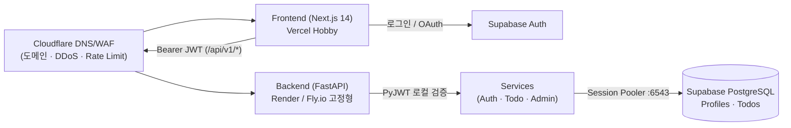

# CLAUDE.md

This file provides guidance to Claude Code (claude.ai/code) and Antigravity (`agy`) when working with code in this repository.

# Personal Hub (To-do-BackendApp) — 에이전트 지침

Next.js(Frontend) + FastAPI(Backend) + Supabase(Auth · PostgreSQL) 기반의 개인 포트폴리오 및 생산성(To-Do · 캘린더 · 관리자 대시보드) 웹 플랫폼이다. 로컬 웹서버 개발을 넘어 **도메인 연결 · 실전 클라우드 배포 · 과금 폭탄(무제한 종량제 위험) 원천 차단 구조와 보안 경계를 구축·검증하는 것**이 핵심 목표다.

## 시작할 때

1. **[`docs/status.md`](docs/status.md) 를 먼저 읽는다** — 지금 단계, 열린 문제, 다음 작업, 사용자가 정할 것.
2. 확정된 결정은 [`docs/decisions.md`](docs/decisions.md) 한 곳에만 둔다. 결정이 필요한 사항은 임의로 확정하지 말고 선택지와 근거를 정리해 올린다.
3. 규칙은 `.claude/rules/` 에 있다. [`workflow.md`](.claude/rules/workflow.md) · [`cost-and-security.md`](.claude/rules/cost-and-security.md) 는 항상 적용되고, [`backend.md`](.claude/rules/backend.md)(`backend/**`) · [`frontend.md`](.claude/rules/frontend.md)(`frontend/**`) · [`docs-writing.md`](.claude/rules/docs-writing.md)(`**/*.md`) 는 해당 경로 파일을 다룰 때 적용된다.
4. 구현 · 리뷰어 · 검증 · 목업 에이전트는 `.claude/agents/` 에 정의되어 있다 — 백엔드 구현(Gemini 4 Argon 전담) [`backend-dev`](.claude/agents/backend-dev.md) · 프론트엔드 구현(Gemini 3.8 Flash 전담) [`frontend-dev`](.claude/agents/frontend-dev.md) · 단독 HTML 디자인 목업 작성(Gemini 3.8 Flash 전담) [`html-mockup-writer`](.claude/agents/html-mockup-writer.md) · 코드 품질 리뷰 [`code-reviewer`](.claude/agents/code-reviewer.md) · 인증/보안/비용 경계 리뷰 [`auth-security-reviewer`](.claude/agents/auth-security-reviewer.md) · 문서 사실 검증 [`docs-reviewer`](.claude/agents/docs-reviewer.md) · 테스트/린트 실행 [`verifier`](.claude/agents/verifier.md).
5. 훅이 막거나 묻는다(`.claude/settings.json` · `.claude/hooks/`): 파괴적 명령 묶음 차단(`destructive-guard.sh`) · git 보호 브랜치 정책(`git-policy.sh`) · 커밋 전 문서 검사(`docs-check-on-commit.sh`) · 주석 규칙(`comment-guard.sh`) · 단순 감싸기 증가 차단(`shape-guard.sh`). `docker build` · `alembic upgrade` · 배포 명령은 먼저 허락을 받는다.

## 문서 지도 — `docs/`

| 무엇 | 어디 |
|---|---|
| 지금 상태 · 다음 작업 · 정할 것 | [`docs/status.md`](docs/status.md) |
| 확정된 결정 (유일한 출처) | [`docs/decisions.md`](docs/decisions.md) |
| 미정 — 초안 · 선택지 · 결정 후보 | `drafts/` (git 밖, 확정되면 `docs/` 로 승격) |
| 절차 (로컬 실행 · DB 마이그레이션 · 도메인/클라우드 배포 · 비용 상한 설정) | [`docs/runbooks/`](docs/runbooks/README.md) |
| 교훈 (조용한 실패 · 보안/비용/설정 사고 기록) | [`docs/lessons/`](docs/lessons/README.md) |
| 점검 · 아키텍처 · 비용 위험 분석 보고서 | [`docs/reports/`](docs/reports/README.md) |
| 지난 계획 · 초기 문서 보관 (판단 근거로 쓰지 않음) | [`docs/archive/`](docs/archive/README.md) |

전체 색인은 [`docs/README.md`](docs/README.md).

## 구조



| 디렉토리 | 무엇 |
|---|---|
| `frontend/` | Next.js 14 App Router(TypeScript, Tailwind CSS) — `src/middleware.ts`(세션 쿠키 갱신) · `src/app/`(라우트 및 서버 가드) · `src/components/`(클라이언트 화면) · `src/lib/`(`api.ts`, `supabase.ts`, `supabase-server.ts`) |
| `backend/` | FastAPI + SQLAlchemy 2.0 + Alembic — `app/main.py`(진입점·CORS) · `app/core/`(`config.py`, `security.py` JWT/RBAC) · `app/api/v1/endpoints/`(얇은 라우터) · `app/services/`(비즈니스 로직) · `app/models/`(ORM) · `app/schemas/`(Pydantic v2) · `tests/`(`pytest`) |
| `tools/` | 문서 · 코드 모양 자동 검사 도구 (`docs_check.py`, `code_shape.py`, `comment_guard.py`, `shape_guard.py`) |
| `docs/` | 확정 정본 문서(`status.md`, `decisions.md`, `runbooks/`, `lessons/`) 및 사실 기록(`reports/`) |
| `drafts/` (git 무시) | 미정 초안 · 선택지 · 임시 분석 문서 |

## 검증

```bash
# 문서 검사 (링크 · 색인 · 머리 두 줄 · 결정 번호 · mermaid 렌더)
python3 tools/docs_check.py

# 백엔드 Python 코드 모양 검사 (단순 감싸기 · 깊은 들여쓰기 · 주석 규칙 · 예외 분기)
python3 tools/code_shape.py backend/app

# 백엔드 단위 시험 (uv run 사용 — .venv 직접 호출 금지)
cd backend && ENVIRONMENT=local PYTHONPATH=. uv run --no-project --python 3.11 --with-requirements requirements.txt pytest tests/

# 프론트엔드 린트 및 타입/빌드 확인
cd frontend && npm run lint
```

빌드(`docker compose up --build`, `next build`) · DB 스키마 변경(`alembic upgrade head`) · 외부 클라우드 배포는 사용자 허락을 받고 실행한다. 에러가 없다고 정상이 아니다 — 종료 코드와 실제 응답·스키마 결과로 판정한다.

## 이 파일을 고칠 때

이 파일은 지도다. **현재 상태 · 상세 수치 · 긴 절차는 여기 쓰지 않는다** — 각각 `docs/status.md` · `docs/reports/` · `docs/runbooks/` 에 쓰고 링크한다. 200줄을 넘기지 않는다.
