# 기준점(Tone 3 + 진한 그린 `#18865B` · 네이버 부동산 스타일) 기반 디자인 아톰(Atoms) 재설계 및 랜딩 페이지 통일 보고서
2026-10-25 · 상태: **현행** · 관련: [docs/status.md](../status.md), [docs/decisions.md](../decisions.md), [2026-10-25_pastel-green-5-tones-research.md](2026-10-25_pastel-green-5-tones-research.md)

## 1. 점검 배경 및 기존 컴포넌트(UI Primitives)의 4대 문제 진단

확정된 워크스페이스 기준점(**Tone 3 무채색 화이트/슬레이트 `#F4F6F8`·`#FFFFFF`·`#E5E8EB` + 진한 제이드 그린 `#18865B` + 파스텔 그린 틴트 `#E6F4EE` + `fin.land.naver.com/map` 스타일**)을 기준으로 현재 코드베이스(`frontend/src/components/ui/*` 및 `frontend/src/app/page.tsx`)를 전수 점검한 결과, 아래 4가지 구조적 문제를 확인했다.

### 케이스 1: 핵심 아톰(`Chip`, `SegmentedToggle`) 부재로 인한 인라인 클래스 파편화
- **문제**: 네이버페이 부동산 스타일 UI의 핵심인 **알약형 필터(`전체 · 진행중 · 완료 · 기한지남`)** 와 **뷰 전환 토글(`▦ Calendar ↔ ≡ List`, `Month ↔ Agenda`)** 이 공용 아톰 없이 각 파일(`TodosPageClient.tsx`, `MonthCalendarGrid.tsx`)마다 `<button className="...">` 문자열로 중복 작성되어 있었다.
- **원인**: `model-hub` 디자인 시스템(`02-atoms.md`)에서 가장 많이 쓰이는 1순위 아톰인 `Chip`(상태 배지 겸 인터랙티브 필터 알약)과 `SegmentedToggle`(`aria-pressed` 단일 선택 토글)을 먼저 정의하지 않고 기본 `Badge` 만 두었기 때문이다.
- **해결**: `frontend/src/components/ui/chip.tsx` 와 `frontend/src/components/ui/segmented-toggle.tsx` 를 최상위 핵심 아톰으로 신설해 모든 필터 알약·상태 태그·뷰 스위처를 단일 규격으로 통일한다.

### 케이스 2: 카드·버튼·입력창의 크기/곡률 부조화 (`rounded-2xl` 과대 패딩 vs 고밀도 워크스페이스)
- **문제**: 기존 `Card`(`rounded-2xl p-6`), `Button`(`h-10` / `h-12 rounded-full`), `Input`(`h-11`)이 마케팅 템플릿처럼 크고 둥글어, `fin.land.naver.com` 특유의 단정하고 치밀한 1줄 툴바 밀도가 나오지 않았다.
- **원인**: 다크 글래스모피즘 시절의 큰 곡률(`16px~24px`)과 넉넉한 여백이 그대로 남아 있었기 때문이다.
- **해결**: 컨트롤 기본 높이를 **`36px`(`h-9`)**, 소형 컨트롤을 **`32px`(`h-8`)**, 카드 곡률을 **`12px`(`rounded-xl`) + `1px solid #E5E8EB` 헤어라인 + 미세 그림자(`0 1px 3px rgba(15,23,42,0.03)`)** 로 교정한다.

### 케이스 3: 상태 색상(Status Color) 3종 세트 미분리
- **문제**: 성공·주의·위험(`⚠ 지남`)·중립 색상이 화면마다 제각각의 Tailwind 클래스로 흩어져 있었다.
- **원인**: `model-hub` 의 `01-foundations.md` §1-2 원칙(**상태 색상은 항상 `fg / bg / border` 3종 세트로만 쓴다**)이 아톰 레벨에 강제되지 않았다.
- **해결**: 모든 상태 표시를 `Chip` 과 `Badge` 아톰의 `tone` prop(`primary` / `success` / `warning` / `danger` / `neutral`)을 통해서만 렌더링하도록 고정한다.

### 케이스 4: 랜딩 페이지(`frontend/src/app/page.tsx`)와 기준점 워크스페이스의 톤앤매너 괴리
- **문제**: 워크스페이스는 깔끔한 네이버 부동산 스타일 라이트 UI로 바뀌었으나, 랜딩 페이지(`app/page.tsx`)에는 어두운 배경용 `/assets/hero_bg.png` 블러 이미지와 거대한 `text-7xl` 홍보성 문구가 남아 있어 같은 서비스처럼 보이지 않았다.
- **원인**: 랜딩 페이지를 별도 마케팅 페이지처럼 구성해 워크스페이스의 아톰(`Chip` 알약 바, 미니 캘린더 Span Bar, 도킹 카드)을 공유하지 않았기 때문이다.
- **해결**: 랜딩 페이지 히어로에서 레거시 배경 이미지를 제거하고, **기준점 워크스페이스와 100% 동일한 `#F4F6F8` 캔버스 + `#FFFFFF` 카드 + `Chip` 알약 스펙 바 + 실시간 미니 워크스페이스 프리뷰 프레임**으로 재설계한다.

---

## 2. 재설계한 4계층 디자인 시스템 아키텍처 (`01 Foundations` ~ `04 Screens`)

```mermaid
flowchart TD
    subgraph L1["01. Foundations (globals.css 시맨틱 토큰)"]
        F1["무채색 골격 (Chroma 0)<br/>Canvas #F4F6F8 · Card #FFFFFF · Border #E5E8EB"]
        F2["Primary Green (Tone 3 Deep Jade)<br/>Solid #18865B · Hover #136C49 · Pastel Tint #E6F4EE/#B6E2CF/#126B48"]
        F3["Status 3-Tuple (fg / bg / border)<br/>Danger(지남) #E5484D/#FFF0F0/#F8C9C9 · Warning · Neutral"]
    end

    subgraph L2["02. Core Atoms (frontend/src/components/ui/)"]
        A1["Chip (ui/chip.tsx)<br/>필터 알약(active) + 상태/카테고리 태그 + 도트/카운트"]
        A2["SegmentedToggle (ui/segmented-toggle.tsx)<br/>aria-pressed 뷰 스위처 (Calendar↔List, Month↔Agenda)"]
        A3["Button & Input (36px h-9 기본 규격)<br/>Primary #18865B · Secondary #E6F4EE · Outline #FFFFFF"]
        A4["Card & Table (rounded-xl · 1px #E5E8EB)<br/>고밀도 슬레이트 헤어라인 컨테이너"]
    end

    subgraph L3["03. Patterns (조립 계약)"]
        P1["1-Line Filter Pill Toolbar<br/>좌측 Chip 묶음(min-w-0 flex-1) + 우측 검색/토글(shrink-0)"]
        P2["Calendar Span & Point Lanes<br/>멀티데이 막대(#E6F4EE) + 오늘 배지(#18865B) + 지남(#FFF0F0)"]
        P3["Split-View Docked Inspector<br/>메인 캔버스(8~9열) + 우측 Task Peek & 백로그 도킹 패널(3~4열)"]
    end

    subgraph L4["04. Screens (전체 화면 톤앤매너 통일)"]
        S1["Landing Page (app/page.tsx)<br/>스펙 Chip 바 + 라이브 워크스페이스 미니 프리뷰 프레임"]
        S2["Todos & Calendar Workspace (TodosPageClient.tsx)"]
        S3["Login & Admin Dashboard (LoginPageClient · AdminDashboardClient)"]
    end

    L1 --> L2
    L2 --> L3
    L3 --> L4

    style L1 fill:#1f6f3f,stroke:#3fb950,color:#ffffff
    style L2 fill:#1f6f3f,stroke:#3fb950,color:#ffffff
    style L3 fill:#7a5a00,stroke:#d29922,color:#ffffff
    style L4 fill:#1f6f3f,stroke:#3fb950,color:#ffffff
```

---

## 3. 아톰(Atoms) 카탈로그 명세표

| 아톰 파일 | 역할 | 핵심 Props 및 규격 | 기준점(`fin.land.naver.com` + `#18865B`) 시각 계약 |
|---|---|---|---|
| [`ui/chip.tsx`](../../frontend/src/components/ui/chip.tsx) | **1순위 아톰** — 알약 필터 버튼 · 카테고리 태그 · 상태 칩 통합 | `tone`(`neutral`·`primary`·`success`·`warning`·`danger`), `shape`(`pill`·`rounded`), `size`(`sm`·`md`), `active`, `dotColor`, `count` | `active=true` 시 `#18865B` 솔리드(흰 글씨, `danger`는 `#E5484D`), `active=false` 시 `#FFFFFF` + `#E5E8EB` 보더, 패시브 `primary`는 `#E6F4EE` 파스텔 그린 틴트 |
| [`ui/segmented-toggle.tsx`](../../frontend/src/components/ui/segmented-toggle.tsx) | 단일 선택 뷰 전환 컨트롤 (`▦ Calendar ↔ ≡ List`, `Month ↔ Agenda`) | `options`, `value`, `onChange`, `size`(`sm`·`md`) | `#F2F4F6` 트랙(`border-[#e5e8eb]`) 위에 선택 항목은 `#18865B` 솔리드 + `aria-pressed="true"` |
| [`ui/button.tsx`](../../frontend/src/components/ui/button.tsx) | 액션 버튼 | `variant`(`default`·`secondary`·`outline`·`destructive`·`ghost`), `size`(`sm: h-8`, `default: h-9`, `lg: h-11`) | 기본 높이 `36px`(`h-9 rounded-lg`), `default`는 `#18865B`(호버 `#136C49`), `secondary`는 `#E6F4EE` 파스텔 그린 틴트 |
| [`ui/input.tsx`](../../frontend/src/components/ui/input.tsx) | 텍스트 · 날짜 · 검색 입력 | `h-9 rounded-lg` 기본 규격 | `#FFFFFF` 배경 + `1px solid #E5E8EB` 보더, 포커스 시 `border-[#18865B]` + `ring-[#18865B]/15` |
| [`ui/card.tsx`](../../frontend/src/components/ui/card.tsx) | 워크스페이스 패널 · 요약 카드 · 모달 표면 | `Card`, `CardHeader`, `CardTitle`, `CardDescription`, `CardContent` | `rounded-xl`(`12px`) + `border-[#E5E8EB]` + `bg-white` + 미세 그림자(`0 1px 3px rgba(15,23,42,0.03)`) |
| [`ui/badge.tsx`](../../frontend/src/components/ui/badge.tsx) | 인라인 소형 상태 라벨 | `variant`(`default`·`secondary`·`success`·`warning`·`destructive`·`outline`) | 3-Tuple(`fg / bg / border`) 엄격 준수 (`default`/`success`=`#E6F4EE`, `destructive`=`#FFF0F0`+`#E5484D`) |

---

## 4. 산출물 및 검증 내역

1. **단독 HTML 아톰 카탈로그 & 랜딩·워크스페이스 통합 목업 (`html-mockup-writer` Flash 3.8 작성)**:
   - `drafts/mockups/design-atoms-and-landing-mock.html` (신규 생성: `🧩 01-03. Design Atoms & Patterns` + `🏠 Landing Page` + `▦ Workspace Baseline` 탭 통합)
   - `drafts/mockups/personal-hub-standalone-mock.html` (최신 아톰 & 랜딩 페이지 포함 버전으로 동기화)
2. **실제 Next.js 프론트엔드 코드 반영 (`frontend-dev` Flash 3.8 작성)**:
   - 신규 아톰: [`chip.tsx`](../../frontend/src/components/ui/chip.tsx), [`segmented-toggle.tsx`](../../frontend/src/components/ui/segmented-toggle.tsx)
   - 교정 아톰: [`button.tsx`](../../frontend/src/components/ui/button.tsx), [`card.tsx`](../../frontend/src/components/ui/card.tsx), [`input.tsx`](../../frontend/src/components/ui/input.tsx), [`badge.tsx`](../../frontend/src/components/ui/badge.tsx)
   - 화면 적용: [`page.tsx` (Landing Page)](../../frontend/src/app/page.tsx), [`TodosPageClient.tsx`](../../frontend/src/components/TodosPageClient.tsx), [`MonthCalendarGrid.tsx`](../../frontend/src/components/todos/MonthCalendarGrid.tsx)
   - 린트 및 타입체크: `docker compose exec -T frontend npm run lint` (`rc=0`), `docker compose exec -T frontend npx tsc --noEmit` (`rc=0`).
