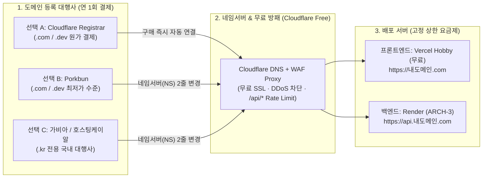

# 도메인 등록 대행사(Registrar) 및 TLD 시장조사 · 비용/보안 비교 보고서

2026-10-25 · 상태: **현행** · 관련: [status](../status.md) · [decisions](../decisions.md) · [과금 폭탄 방지 배포 런북](../runbooks/cost-safe-deployment.md)

개인 포트폴리오 및 생산성 허브(Personal Hub)를 외부에 배포할 때 연결할 **도메인 확장자(TLD)별 특성과 등록 대행사(Registrar)별 연간 유지비·보안·숨은 과금 함정**을 조사한 보고서다.

---

## 1. 도메인 구매 → Cloudflare 앞단 방어선 → 서버 연결 구조

어느 업체에서 도메인을 사더라도, **DNS(네임서버)와 트래픽 프록시는 Cloudflare(무료 플랜)에 연결**하는 것이 과금 폭탄 및 DDoS 방어의 핵심이다(결정 CS-2).

---

## 2. 도메인 확장자(TLD) 선택 비교 (`.com` vs `.dev` vs `.kr` vs `.me`)

개인 포트폴리오 및 개발자 허브 용도로 가장 많이 쓰이는 4개 확장자 비교다.

### 케이스 1: `.com` (가장 무난한 글로벌 표준)
- **특징**: 가장 신뢰도가 높고 기억하기 쉬운 표준 도메인이다.
- **장단점**: 원하는 짧은 단어는 이미 선점된 경우가 많으나, `이름-hub.com` 또는 `이니셜dev.com` 형태로 조합하면 쉽게 등록할 수 있다.
- **연간 비용(원가 기준)**: 약 **$10.46 / 년** (한화 약 14,500원).

### 케이스 2: `.dev` (개발자 포트폴리오 특화 — Google 운영)
- **특징**: Google Registry 가 운영하는 개발자·기술 프로젝트 전용 도메인이다.
- **장단점**: 개발자 포트폴리오로서 상징성이 매우 뛰어나고 깔끔한 이름이 많이 남아 있다. **단, 브라우저(HSTS Preload 목록)에 의해 무조건 `HTTPS` 접속만 허용**되므로 로컬 테스트나 서브도메인 연결 시에도 반드시 SSL 인증서(Vercel · Render · Cloudflare 모두 무료 자동 발급)가 켜져 있어야 한다.
- **연간 비용(원가 기준)**: 약 **$12.20 / 년** (한화 약 17,000원).

### 케이스 3: `.kr` 또는 `.pe.kr` (국내 표준)
- **특징**: 한국인터넷진흥원(KISA) 관할 국가 도메인이다.
- **장단점**: 짧은 영문/이름 선점이 쉽고 국내 사용자에게 친숙하다. **단, Cloudflare Registrar 나 Porkbun 같은 해외 원가 대행사에서는 구매할 수 없고**, 반드시 국내 대행사(가비아, 호스팅케이알 등)에서 구매한 뒤 네임서버만 Cloudflare 로 바꿔야 한다.
- **연간 비용**: 호스팅케이알 기준 약 **9,800원~11,000원 / 년**(부가세 별도), 가비아 기준 약 **22,000원 / 년**(부가세 별도).

### 케이스 4: `.me` / `.io` / `.ai` (주의가 필요한 확장자)
- **문제**: 첫해 할인 또는 유행으로 구매했다가 연장 비용이 비싼 경우가 많다.
- **비교**:
  - `.me`: 첫해는 저렴($5~$10)하나 2년 차 연장 시 $15~$20 수준.
  - `.io`: 연간 **$40~$60 (약 6~8만 원)** 수준으로 유지비가 비싸다.
  - `.ai`: 기본 2년 등록 필수에 연간 **$70~$100 (2년 결제 시 약 20만 원)** 이므로 개인 저비용 프로젝트에는 적합하지 않다.

---

## 3. 등록 대행사(Registrar) 4곳 실측 비교 (2026년 기준)

| 구분 | Cloudflare Registrar | Porkbun | 호스팅케이알 (Hosting.kr) | 가비아 (Gabia) |
| :--- | :--- | :--- | :--- | :--- |
| **가격 정책** | **도매 원가 100% (마진 $0)** | 원가 + 약 $0.5~$1 마진 | 국내 최저가 수준 | 국내 인지도 1위 (정가 높음) |
| **`.com` 연간 비용 (신규=연장)** | **약 $10.46** (~1.45만 원) | **약 $11.08** (~1.55만 원) | 약 14,200원 (VAT 포함) | 27,500원 (VAT 포함, 첫해만 할인) |
| **`.dev` 연간 비용 (신규=연장)** | **약 $12.20** (~1.7만 원) | **약 $12.87** (~1.8만 원) | 약 22,000원 내외 | 약 35,090원 (VAT 포함) |
| **`.kr` 지원 여부** | 미지원 | 미지원 | **지원 (약 10,890원, 저렴)** | **지원 (24,200원, VAT 포함)** |
| **WHOIS 개인정보 보호** | 무료 기본 적용 | 무료 기본 적용 | 무료 제공 | 무료 제공 |
| **Cloudflare WAF 연동** | **구매 즉시 자동 연동 (설정 0초)** | 네임서버(NS) 수동 변경 필요 | 네임서버(NS) 수동 변경 필요 | 네임서버(NS) 수동 변경 필요 |
| **특이사항 / 제약** | 네임서버를 타사로 변경 불가 (어차피 Cloudflare WAF를 쓸 것이므로 단점 아님) | 외부 네임서버 변경 자유로움, UI 직관적 | 국내 카드/간편결제 지원, `.kr` 가성비 최고 | 첫해 할인가와 2년 차 연장가 차이가 큼 |

---

## 4. 도메인 구매 시 피해야 할 과금/보안 함정 3가지

1. **"첫해 $1 (또는 1,000원)" 프로모션의 연장 요금 함정**:
   - GoDaddy, Namecheap, 국내 일부 호스팅사는 첫해 `.com` 도메인을 $1~5,000원에 팔고, **자동 결제(Auto-renew)가 걸린 2년 차부터 연 3만~5만 원($25~$35)을 청구**한다.
   - 반드시 **첫해 등록 가격과 2년 차 이후 연장(Renewal) 가격이 동일한 곳(Cloudflare Registrar, Porkbun, 호스팅케이알)**을 골라야 한다.
2. **WHOIS 개인정보 보호(Privacy Protection) 유료 옵션 함정**:
   - 도메인을 등록하면 ICANN 규정상 소유자의 이름·이메일·전화번호·주소가 공개 데이터베이스(WHOIS)에 등록된다. 일부 업체는 이를 가려주는 Privacy 기능을 연 1만 원짜리 유료 부가서비스로 판다.
   - Cloudflare 와 Porkbun 은 **WHOIS Redaction(개인정보 마스킹)이 영구 무료 기본값**으로 켜져 있어 스팸 메일과 개인정보 노출을 막아준다.
3. **부가 상품(웹호스팅 · 유료 SSL · 유료 DNS) 끼워팔기 주의**:
   - 도메인 결제창에서 "프리미엄 DNS(월 2,000원)", "SSL 인증서(연 3만 원)" 같은 체크박스가 기본 선택되어 있는 경우가 있다.
   - SSL 인증서와 글로벌 Anycast DNS, WAF 는 **Cloudflare Free 플랜과 Vercel · Render 에서 모두 무료로 자동 발급**되므로, 도메인 등록비 외의 부가 옵션은 전부 해제해야 한다.

---

## 5. 상황별 최종 권고안

- **권고 1 (`.com` 또는 `.dev` 를 원할 때 — 가장 추천)**: **Cloudflare Registrar**
  - 어차피 앞단 방어선(DDoS · Rate Limit, 결정 CS-2)으로 Cloudflare 를 사용할 예정이므로, Cloudflare 대시보드 안에서 도메인을 원가($10.46 또는 $12.20)로 구매하면 네임서버 변경이나 전파 대기 시간 없이 즉시 연결된다.
- **권고 2 (`.kr` 도메인을 원하거나 국내 원화 결제가 편할 때)**: **호스팅케이알(Hosting.kr)**
  - 국내 대행사 중 연장 비용 거품이 가장 적다(`.kr` 연 1만 원대 초반). 구매 직후 도메인 관리 화면에서 네임서버(Nameserver)만 Cloudflare 가 알려주는 주소 2개로 바꿔주면 동일한 보안·방어 구조를 쓸 수 있다.
