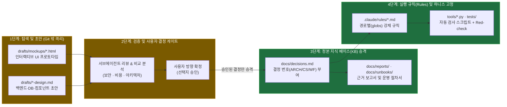

# To-Do + 캘린더 워크스페이스 초안 설계 및 초안→지식베이스·룰 승격 체계 비교 분석
2026-10-25 · 상태: **현행** · 관련: [docs/status.md](../status.md), [docs/decisions.md](../decisions.md), [2026-10-25_project-inspection-and-cost-architecture.md](2026-10-25_project-inspection-and-cost-architecture.md)

## 1. 목적 및 배경

1. **계정별 To-Do + 캘린더 워크스페이스 고도화**: 웹 디자인 레퍼런스(Linear, Notion Calendar, Todoist)와 로컬 레퍼런스 저장소(`model-hub`)의 검증된 패턴을 결합해 파스텔 민트(`#8ee3be`) 테마의 **HTML 프로토타입 초안**, **백엔드·DB 스키마 초안**, **프론트엔드 컴포넌트 설계 및 실제 코드 이식**을 수행한다.
2. **초안(Draft) → 지식 베이스(KB) 및 규칙(Rules) 승격 체계 분석**: 미확정 초안이 어떻게 정본 문서(`docs/`)와 강제 규칙(`.claude/rules/` + 자동 검증 하니스)으로 승격되는지 웹 업계 표준(ADR · 3-Tier Context Engineering)과 `model-hub`, 현재 저장소(`Personal Hub`)를 비교 분석한다.

---

## 2. 웹 디자인 레퍼런스 조사 및 `model-hub` 벤치마킹 결과

### 2.1 웹 레퍼런스 핵심 UX 패턴
- **Notion Calendar & Linear Cycles**:
  - 단일 데이터셋을 공유하는 **`▦ Calendar` ↔ `≡ List` 즉시 전환** 및 상단 단일 필터 바(상태 · 우선순위 · 검색어).
  - 시작일과 마감일이 모두 있는 작업(`started_on ~ due_date`)은 월간 그리드 상단 레인에 **연속 막대(Multi-day Span Bar)** 로 표시하고, 단일 일자 마감 작업은 날짜 셀 내부에 **포인트 칩(Point Pill)** 으로 분리.
- **Todoist Upcoming & Overdue Hierarchy**:
  - **날짜 미지정 백로그 우측 레일(Undated Backlog Rail)**: 마감일이 없는 할 일을 우측 레일에 모아 두고, 캘린더에서 날짜를 선택한 뒤 클릭 한 번으로 즉시 배정.
  - **단일 완료/지연 시각 규칙(One Completion & Overdue Rule)**: 완료된 항목은 `✓` + 저채도 취소선으로 낮추고, 미완료이면서 오늘(`today`)을 지난 항목은 절대 흐리게 처리하지 않고 코랄 레드(`⚠ 지남`) 배지로 강조.

### 2.2 `model-hub` 저장소에서 차용한 핵심 아키텍처 및 컴포넌트 패턴
- **프론트엔드(`webapp/frontend/src/components/projects/calendar/`)**:
  - 월요일 시작 6주(42일) 그리드 및 주간 행(Week Row) 단위 멀티데이 Span Bar 레인 패킹 알고리즘(`calendar-math.ts`).
  - 리스트 뷰 상단에 5주(35일) 일정 밀도를 한눈에 보여주는 **5-Week Schedule Mini Strip**(`ScheduleMiniStrip.tsx`).
  - 캘린더 칩 클릭 시 모달 대신 우측 레일 상단에서 상세 정보와 상태 변경을 처리하는 **Side Peek Inspector**(`UndatedBacklogRail.tsx`).
- **백엔드 및 DB 스키마(`docs/rules/backend-architecture-rules.md`, `db-schema-rules.md`)**:
  - **계층 분리(`P1~P5`, `R1~R5`, `C1~C5`)**: ORM 모델과 Pydantic 스키마 분리, 라우터 직접 쿼리 금지, 쓰기/트랜잭션(`services.py`)과 읽기 조립(`queries.py`) 분리.
  - **DB 스키마(`S1~S8`)**: `profiles.user_uuid` + `todos.user_id` 계정 격리, 소프트 삭제 3종 세트(`deleted_at`, `deleted_by`, `delete_reason`) 및 활성 행 부분 인덱스(`WHERE deleted_at IS NULL`), DB `ENUM` 대신 `VARCHAR + Pydantic Literal` 사용.

---

## 3. 산출물 요약 (초안 3종 + 프론트엔드 실제 반영)

미확정 설계와 프로토타입은 미정 초안 및 결정 후보를 git 추적 밖 `drafts/` 폴더에 격리하는 원칙(WF-5)에 따라 `drafts/` 아래에 작성하고, 프론트엔드 컴포넌트 구조는 실제 `frontend/src/components/todos/` 에 심어 즉시 동작하도록 연결했다.

| 구분 | 경로 | 핵심 내용 |
|---|---|---|
| **HTML 인터랙티브 초안** | `drafts/mockups/todo-calendar-workspace.html` | 파스텔 민트(`#8ee3be`) 다크 테마 기준 `▦ Calendar View`(멀티데이 Span Bar + 미지정 레일 + 상세 Peek), `≡ List View`(5주 미니 스트립 + 인라인 리스트), `설계 요약` 탭 전환형 단독 HTML 목업 |
| **백엔드 · DB 스키마 설계서** | `drafts/backend-and-db-schema-design.md` | FastAPI 계층 분리(`endpoints` / `services` / `queries` / `models` / `schemas`) + `profiles`·`todos`·`todo_categories` ERD + 무제한 종량제 금지 및 고정 상한 요금제 사용(CS-1) · 입력 길이 및 조회 상한 강제(CS-3) · 로컬 JWT 검증(CS-4) 결합 설계 |
| **프론트엔드 컴포넌트 설계서** | `drafts/frontend-component-design.md` | `model-hub` 의 `05-design-brief.md` 양식을 따른 화면 IA, 컴포넌트 트리, URL/상태 전이 및 시각 규칙 명세 |
| **프론트엔드 실제 컴포넌트 이식** | [types.ts](../../frontend/src/components/todos/types.ts), [calendar-math.ts](../../frontend/src/components/todos/calendar-math.ts), [MonthCalendarGrid.tsx](../../frontend/src/components/todos/MonthCalendarGrid.tsx), [UndatedBacklogRail.tsx](../../frontend/src/components/todos/UndatedBacklogRail.tsx), [ScheduleMiniStrip.tsx](../../frontend/src/components/todos/ScheduleMiniStrip.tsx), [TodosPageClient.tsx](../../frontend/src/components/TodosPageClient.tsx) | `▦ Calendar` ↔ `≡ List` 전환, Month/Agenda 뷰, 5주 미니 타임라인, 날짜 미지정 백로그 빠른 배정, Task Peek 인스펙터, 빈 워크스페이스용 샘플 일정 미리보기 토글 구현 (`npm run lint` · `tsc --noEmit` 통과) |

---

## 4. 초안(Draft) → 지식 베이스(KB) 및 룰(Rules) 승격 방법 비교 분석

웹 검색을 통해 조사한 **엔지니어링 ADR(Architecture Decision Record) 및 AI 에이전트 컨텍스트 계층화(3-Tier Context Hierarchy) 표준**과 `model-hub`, 현재 `Personal Hub` 의 방식을 케이스별로 비교한다.

### 4.1 케이스별 상세 비교 (문제 → 원인 → 방식 비교)

#### 케이스 1: 웹 업계 표준 (Michael Nygard ADR + AI Context Engineering 3-Tier Memory)
- **해결하려는 문제**: 초안 문서와 확정된 설계 문서가 한 폴더에 섞이면 개발자와 AI 에이전트 모두 "폐기된 초안"을 현행 규칙으로 오인해 잘못된 코드를 생성한다(Context Poisoning).
- **원인**: 문서의 상태 전이(`Proposed` → `Accepted` → `Superseded`)와 에이전트 컨텍스트 로딩 범위(항상 읽는 규칙 vs 필요할 때만 읽는 참고 문서)가 분리되지 않았기 때문이다.
- **핵심 방식**:
  1. **Tier 1 (Scratchpad / RFC Drafts)**: 임시 탐색 초안은 정본 지식 베이스 밖에 두어 기본 컨텍스트를 오염시키지 않는다.
  2. **Tier 2 (Knowledge Base / ADRs)**: 승인된 설계만 불변 번호(`ADR-001` 등)를 부여해 정본 저장소에 커밋한다.
  3. **Tier 3 (Path-Scoped Rules + Linter)**: 자주 위반되는 아키텍처 제약만 경로 필터(`paths: ["backend/**"]`)가 붙은 짧은 규칙 파일(`.claude/rules/`)과 정적 검사 도구로 승격한다.

#### 케이스 2: `model-hub` 저장소 (`/Users/bill/Desktop/dev/local_dev/model-hub`)
- **해결하려는 문제**: 대규모 풀스택 앱에서 UI 목업, DB 스키마 변경, 백엔드 레이어 규칙이 문서로만 남고 실제 코드에서 조용히 어긋나는 현상.
- **원인**: 자연어 규칙만으로는 에이전트가 편의를 위해 라우터에 직접 SQL을 작성하거나 ORM 객체를 그대로 반환하는 실수를 막기 어렵다.
- **핵심 방식**:
  1. **초안 단계**: UI는 `.claude/.local/mockups/*.html`(git 무시)로 먼저 시각화하고, 화면 계약은 `docs/design-system/05-design-brief.md` 에, 실행 계획은 `docs/plans/current-phase.md` 에 작성한다.
  2. **멀티 리뷰 게이트**: 구현 전 `plan-reviewer`, `db-reviewer`, `ui-ux-reviewer` 서브에이전트가 규칙 번호(`P1~P5`, `S1~S8`) 기준으로 초안을 검증한다.
  3. **하니스 고정 + Red-check**: 규칙을 `docs/rules/*.md` 에 추가할 때 반드시 `tests/harness/` 아래에 AST/스키마 검사 테스트를 함께 작성하고, **일부러 코드를 깨뜨려 테스트가 실패를 잡는지 확인(Red-check)** 한 뒤 `git mv` 로 계획서를 `docs/decisions/` 로 이관한다.

#### 케이스 3: `Personal Hub` 현행 체계 (`To-do-BackendApp`)
- **해결하려는 문제**: 소규모 개인 플랫폼에서 과도한 문서 파편화를 막으면서도, 클라우드 과금 폭탄 차단과 인증/권한 경계를 흔들림 없이 유지해야 한다.
- **원인**: 결정 사항이 여러 파일에 흩어지면 무엇이 확정된 결정인지 추적하기 어렵다.
- **핵심 방식**:
  1. **초안 격리(WF-5)**: 미정 초안 · 선택지 · HTML 목업은 git 무시 폴더인 `drafts/` 에만 둔다.
  2. **단일 결정 출처**: 사용자가 확정한 결정만 [`docs/decisions.md`](../decisions.md) 에 번호(`WF-*`, `CS-*`, `ARCH-*`)를 부여해 기록한다.
  3. **문서·코드 자동 가드**: `tools/docs_check.py` 가 문서 머리 두 줄, 색인 누락, 미등록 결정 번호, Mermaid 문법을 검사하고, `tools/code_shape.py` 및 `.claude/hooks/` 가 단순 감싸기 함수 증가와 주석 규칙을 기계적으로 차단한다.

### 4.2 3개 체계 요약 비교표

| 비교 항목 | 웹 업계 표준 (ADR + 3-Tier Context) | `model-hub` 체계 | `Personal Hub` (`To-do-BackendApp`) |
|---|---|---|---|
| **초안(Draft) 보관 위치** | 별도 RFC 브런치 또는 Scratchpad | `.claude/.local/mockups/` + `docs/plans/current-phase.md` | `drafts/` (git 무시 폴더, WF-5) |
| **지식 베이스(KB) 정본** | `docs/adr/0001-*.md` 개별 파일 | `docs/decisions/*.md` + `docs/design-system/` | [`docs/decisions.md`](../decisions.md) 단일 파일 + `docs/reports/` · `docs/runbooks/` |
| **규칙(Rules) 코드화** | `.cursor/rules/` · `.claude/rules/` (경로 스코프) | `docs/rules/backend-architecture-rules.md` (`P#`, `R#`, `C#`), `db-schema-rules.md` (`S#`) | `.claude/rules/{workflow,cost-and-security,backend,frontend,docs-writing}.md` |
| **기계적 강제 수단(Harness)** | CI Linter / ArchUnit / Dependency Cruiser | `tests/harness/` (pytest 기반 AST · DB 스키마 검사 + **Red-check 필수**) | `tools/docs_check.py`, `tools/code_shape.py`, `.claude/hooks/*.sh` |

---

## 5. `Personal Hub` 에 도입할 권고 승격 파이프라인 (Feedback)

현재 `Personal Hub` 의 **단일 정본 결정(`docs/decisions.md`) + `drafts/` 격리(WF-5)** 구조는 간결하고 명확하므로 그대로 유지하되, `model-hub` 에서 효과가 검증된 **3가지 장치**를 결합하는 것을 권고한다.

1. **UI 변경 전 `drafts/mockups/*.html` → 컴포넌트 이식 순서 고정 (권고 1)**:
   - 복잡한 화면(캘린더 · 대시보드 등)은 이번 작업처럼 `drafts/mockups/` 에 단독 실행 가능한 HTML 초안을 먼저 만들고, 사용자가 레이아웃을 확인한 뒤 `frontend/src/components/` 로 이식한다.
2. **백엔드·DB 규칙 번호 체계(`P/R/C`, `S1~S8`)의 `.claude/rules/backend.md` 편입 (권고 2)**:
   - `drafts/backend-and-db-schema-design.md` 에 설계한 `queries.py` 분리(읽기 조립과 쓰기 트랜잭션 분리), 소프트 삭제 3종 세트(`deleted_at`, `deleted_by`, `delete_reason`), 부분 인덱스(`WHERE deleted_at IS NULL`) 규칙을 사용자가 승인하면 `docs/decisions.md` 에 등록하고 `.claude/rules/backend.md` 에 번호와 함께 승격한다.
3. **규칙 승격 시 AST/스키마 하니스 + Red-check 동반 (권고 3)**:
   - 규칙 문서만 고치지 않고, `backend/tests/test_architecture_harness.py` 또는 `tools/code_shape.py` 에 검사 로직(예: 라우터 내 `db.query` 직접 호출 금지, 모든 요청 스키마 문자열 필드 `max_length` 존재 여부 검사)을 추가한 뒤 실제로 위반 코드를 넣어 실패하는지 확인(Red-check)한다.
