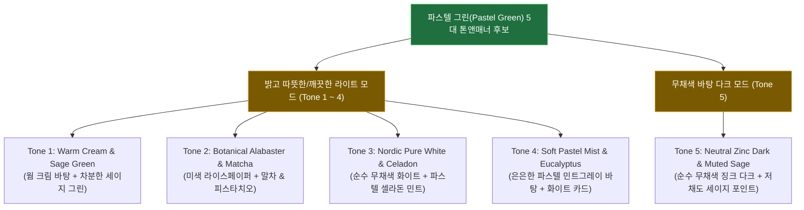

# 파스텔 그린(Pastel Green) 웹 UI 톤앤매너 5선 비교 조사 보고서
2026-10-25 · 상태: **현행** · 관련: [docs/status.md](../status.md), [docs/decisions.md](../decisions.md), [2026-10-25_draft-to-kb-and-rules-promotion.md](2026-10-25_draft-to-kb-and-rules-promotion.md)

## 1. 기존 색상 톤이 어색했던 원인 진단 (문제 → 원인 → 해결 원칙)

- **문제**: 직전 시안(`#070b09` 딥 포레스트 배경 + `#8ee3be` 민트)은 사용자가 의도한 부드럽고 세련된 "파스텔 톤 녹색"이 아니라, 어두운 사이버펑크/터미널 화면처럼 보였다.
- **원인**:
  1. **배경·카드·보더까지 전부 녹색을 섞음**: 배경(`#070b09`), 카드(`#0d1512`), 테두리(`emerald-200/12`), 보조 글자(`emerald-100/60`)까지 모두 녹색 채도를 넣으면, 정작 주인공인 파스텔 그린 포인트 색상이 묻히고 화면 전체가 무거워진다.
  2. **어두운 바탕 위 고명도 민트의 형광 착시**: 검정에 가까운 바탕 위에서는 파스텔 민트(`#8ee3be`)가 대비 때문에 형광 네온 그린처럼 발광해 보인다.
- **해결 원칙 (60-30-10 법칙 & `model-hub` 무채색 골격 원칙)**:
  - 화면의 **85~90%(바탕 · 카드 · 기본 테두리 · 본문 텍스트)는 녹색 기운이 없는 깨끗한 중립색(웜 크림, 순백, 무채색 슬레이트/징크)** 으로 잡아 여백과 가독성을 확보하고, **파스텔 그린(세이지 · 말차 · 피스타치오 · 셀라돈)은 10~15%(Primary 버튼 · 캘린더 기간 막대 · 활성 탭 · 선택 뱃지)** 에만 절제해서 쓴다.

---

## 2. 파스텔 그린 디자인 톤앤매너 5가지 후보

웹 디자인 레퍼런스(Notion, Linear, Craft, Todoist, Apple Reminders)와 컬러 시스템 조사를 바탕으로, 성격이 뚜렷하게 다른 **5가지 파스텔 그린 톤앤매너**를 정리했다. 단독 HTML 비교 목업(`drafts/mockups/pastel-green-5-tones-comparison.html`)에서 상단 `1~5` 버튼으로 실시간 전환해 볼 수 있다.

### 케이스 1: Warm Cream & Sage Green (웜 크림 & 세이지 그린 — 웜 라이트)
- **분위기 및 레퍼런스**: Notion · Kinfolk 매거진 · 고급 종이 다이어리 감성. 눈부신 순백 대신 따뜻한 미색(`#F7F6F2`) 바탕 위에 흰색 카드를 올리고, 채도를 낮춘 파스텔 세이지 그린(`#9CAF88`)을 포인트로 쓴다.
- **팔레트 구성**:
  - 바탕(Canvas): `#F7F6F2` (Soft Cream / Bone)
  - 카드(Surface): `#FFFFFF` (Pure White) / 보더: `#E3E7DF` (Light Sage Gray)
  - 본문 텍스트: `#2C3531` (Slate Charcoal) / 보조 텍스트: `#707973` (Gray Moss)
  - **Primary (파스텔 그린)**: `#9CAF88` (Sage Green, 호버 `#7E8F6C`)
  - **캘린더 막대 / 칩 배경**: `#E6EFE2` (Soft Sage Tint, 텍스트 `#2E472D`)
  - 기한 지남(Overdue): `#D68C85` (Dusty Coral — 파스텔 톤을 깨지 않는 코랄)

### 케이스 2: Botanical Alabaster & Matcha Pistachio (보태니컬 라이스페이퍼 & 말차 피스타치오 — 내추럴 라이트)
- **분위기 및 레퍼런스**: Craft Docs · Todoist 보태니컬 테마. 말차(Matcha)와 피스타치오 크림(`#E2F0DB`)의 조합으로, 케이스 1보다 녹색의 생기와 파스텔 크림 질감이 조금 더 뚜렷하다.
- **팔레트 구성**:
  - 바탕(Canvas): `#F6F7F2` (Warm Rice Paper)
  - 카드(Surface): `#FCFBF9` (Soft Alabaster) / 보더: `#D9DEC9` (Muted Reed)
  - 본문 텍스트: `#284221` (Deep Matcha Slate) / 보조 텍스트: `#6A7B65` (Olive Gray)
  - **Primary (파스텔 그린)**: `#6C8F72` (Eucalyptus Matcha, 호버 `#55725A`)
  - **캘린더 막대 / 칩 배경**: `#E2F0DB` (Soft Pistachio, 텍스트 `#284221`)
  - 기한 지남(Overdue): `#D9776C` (Terracotta Rose)

### 케이스 3: Nordic Pure White & Celadon Mint (노르딕 무채색 화이트 & 파스텔 셀라돈 — 모던 SaaS 라이트)
- **분위기 및 레퍼런스**: Linear Light · Stripe · `model-hub` 라이트 모드 원칙. 배경(`#F8FAFC`), 카드(`#FFFFFF`), 보더(`#E2E8F0`), 텍스트(`#0F172A`)에 노란기나 녹색기를 **0%** 로 완전히 빼고, 오직 버튼·선택 날짜·캘린더 Span Bar에만 맑은 파스텔 셀라돈 민트(`#68A691` / `#E3F2EC`)를 얹는다.
- **팔레트 구성**:
  - 바탕(Canvas): `#F8FAFC` (Cool Alabaster, 순수 무채색)
  - 카드(Surface): `#FFFFFF` (Pure White) / 보더: `#E2E8F0` (Neutral Slate Border)
  - 본문 텍스트: `#0F172A` (Deep Slate) / 보조 텍스트: `#64748B` (Cool Gray)
  - **Primary (파스텔 그린)**: `#68A691` (Pastel Celadon Mint, 호버 `#528E7A`)
  - **캘린더 막대 / 칩 배경**: `#E3F2EC` (Celadon Mint Tint, 텍스트 `#1E4E3E`)
  - 기한 지남(Overdue): `#E16B64` (Soft Rose Red)

### 케이스 4: Soft Pastel Mist & Dusty Eucalyptus (파스텔 미스트 캔버스 & 더스티 유칼립투스 — 파스텔 톤온톤)
- **분위기 및 레퍼런스**: Apple Reminders · Daylight Computer · 파스텔 문구류 감성. 배경 자체를 아주 옅은 파스텔 민트그레이(`#EDF3F0`)로 깔고, 그 위에 새하얀 카드(`#FFFFFF`)가 떠 있는 구조로 "파스텔 그린 테마"라는 인상이 첫눈에 가장 화사하게 들어온다.
- **팔레트 구성**:
  - 바탕(Canvas): `#EDF3F0` (Soft Pastel Mint-Gray Mist)
  - 카드(Surface): `#FFFFFF` (Crisp Floating Card) / 보더: `#D5E2DC` (Soft Eucalyptus Border)
  - 본문 텍스트: `#1E2E28` (Forest Charcoal) / 보조 텍스트: `#637870` (Muted Eucalyptus Gray)
  - **Primary (파스텔 그린)**: `#76A892` (Pastel Mint Leaf, 호버 `#5E8F7A`)
  - **캘린더 막대 / 칩 배경**: `#DDF0E7` (Pastel Mint Pill, 텍스트 `#204838`)
  - 기한 지남(Overdue): `#E08279` (Pastel Coral)

### 케이스 5: Neutral Zinc Dark & Low-Chroma Sage (무채색 징크 다크 & 저채도 파스텔 세이지 — 모던 다크)
- **분위기 및 레퍼런스**: Linear Dark · `model-hub` 다크 모드 원칙. 다크 모드를 유지하고 싶을 때 쓰는 정석 배색으로, **배경(`#16171A`)과 카드(`#1E2024`), 보더(`#2C2F36`)에서 녹색 기운을 완전히 제거**하고, 포인트 색만 형광기가 없는 차분한 파스텔 세이지(`#A3C1AD`)로 쓴다.
- **팔레트 구성**:
  - 바탕(Canvas): `#16171A` (Neutral Charcoal Zinc — 녹색기 0%)
  - 카드(Surface): `#1E2024` (Neutral Dark Slate) / 보더: `#2C2F36` (Neutral Zinc Hairline)
  - 본문 텍스트: `#F1F3F5` (Off-White) / 보조 텍스트: `#8A919E` (Neutral Gray)
  - **Primary (파스텔 그린)**: `#A3C1AD` (Low-Chroma Pastel Sage, 버튼 텍스트 `#142219`)
  - **캘린더 막대 / 칩 배경**: `rgba(163, 193, 173, 0.16)` (Subtle Sage Tint, 텍스트 `#C5DEC9`)
  - 기한 지남(Overdue): `#E5857B` (Muted Coral)

---

## 3. 한눈에 보는 5가지 톤앤매너 요약 비교표

| 구분 | 모드 | 바탕(Canvas) | 카드(Surface) | Primary 파스텔 그린 | 칩/막대 서브 배경 | 핵심 인상 및 추천 대상 |
|---|---|---|---|---|---|---|
| **Tone 1. Warm Cream & Sage** | 라이트 (웜) | `#F7F6F2` | `#FFFFFF` | `#9CAF88` (세이지) | `#E6EFE2` | 차분하고 따뜻한 감성 다이어리/노션 느낌 (가장 눈이 편안함) |
| **Tone 2. Botanical & Matcha** | 라이트 (내추럴) | `#F6F7F2` | `#FCFBF9` | `#6C8F72` (말차) | `#E2F0DB` (피스타치오) | 말차·피스타치오 크림 톤의 싱그러운 보태니컬 워크스페이스 |
| **Tone 3. Nordic White & Celadon** | 라이트 (쿨 무채색) | `#F8FAFC` | `#FFFFFF` | `#68A691` (셀라돈) | `#E3F2EC` | 군더더기 없는 무채색 SaaS 바탕에 파스텔 민트만 깔끔하게 강조 |
| **Tone 4. Pastel Mist & Eucalyptus** | 라이트 (파스텔 바탕) | `#EDF3F0` | `#FFFFFF` | `#76A892` (민트리프) | `#DDF0E7` | 바탕부터 은은한 파스텔 민트빛이 감도는 화사한 톤온톤 |
| **Tone 5. Neutral Zinc & Dark Sage** | 다크 (무채색) | `#16171A` | `#1E2024` | `#A3C1AD` (소프트 세이지) | `rgba(163,193,173,0.16)` | 다크 모드이면서 네온/터미널 느낌 없이 무채색 위에 세이지만 얹은 톤 |
