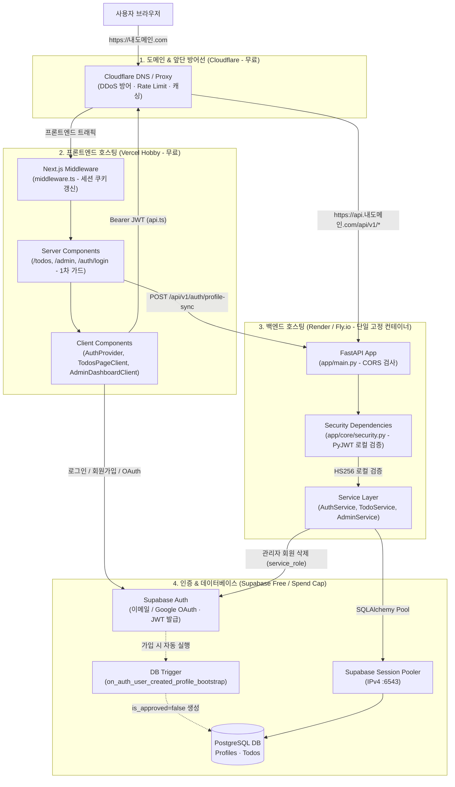
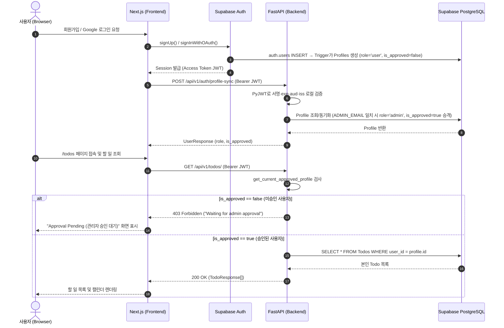

# 프로젝트 점검 · 시스템 아키텍처 및 비용 안전 배포 분석 보고서

2026-10-25 · 상태: **현행** · 관련: [status](../status.md) · [decisions](../decisions.md) · [배포 런북](../runbooks/cost-safe-deployment.md)

Personal Hub (`To-do-BackendApp`) 전체 코드베이스 정적 점검 결과, `shadcn/ui` 도입 여부, Mermaid 시스템 아키텍처, 그리고 도메인 연결·실전 배포 시 과금 폭탄 위험 지점을 정리한 보고서다.

---

## 1. 프론트엔드 `shadcn/ui` 도입 여부 점검

**결론: 도입되어 있지 않다.** 순수 Tailwind CSS 유틸리티 클래스와 `lucide-react` 아이콘만 사용 중이다.

| 점검 항목 | `shadcn/ui` 도입 시 필요한 구성 | 현재 프로젝트 실제 상태 (`frontend/`) |
| :--- | :--- | :--- |
| 설정 파일 | `frontend/components.json` | 없음 |
| UI 부품 폴더 | `frontend/src/components/ui/` | 없음 (`src/components/` 아래 페이지 컴포넌트 6개만 존재) |
| 필수 패키지 | `@radix-ui/*`, `class-variance-authority`, `clsx`, `tailwind-merge`, `tailwindcss-animate` | `frontend/package.json` 에 `lucide-react` 외 모두 없음 |
| 유틸리티 함수 | `frontend/src/lib/utils.ts` (`cn()` 함수) | 없음 |
| Tailwind 설정 | `frontend/tailwind.config.ts` 에 CSS 변수 토큰 및 `animate` 플러그인 등록 | 기본 `background`, `foreground` 만 정의되어 있고 `plugins: []` 가 비어 있음 |

---

## 2. 시스템 아키텍처 및 인증·데이터 흐름 (Mermaid)

### 2.1. 전체 시스템 및 비용 방어 배포 아키텍처

### 2.2. 사용자 가입 · 관리자 승인 · API 호출 시퀀스

---

## 3. 코드베이스 정적 점검 발견 사항 (문제 → 원인 → 비교)

### 3.1. To-Do 생성 시 `due_date` 타입 불일치 (422 에러 위험)
- **문제**: 프론트엔드에서 할 일 추가 시 백엔드 Pydantic 스키마 검증에서 실패할 위험이 있다.
- **원인**: `frontend/src/components/TodosPageClient.tsx:91` 은 `new Date().toISOString()`(전체 타임스탬프 문자열)을 보내고 DB 모델(`backend/app/models/todo.py:14`)도 `DateTime(timezone=True)` 이지만, 스키마(`backend/app/schemas/todo.py:8`)는 `Optional[date]` 로 선언되어 있다.
- **비교**: Pydantic v2 의 `date` 타입은 시간(`T...`)이 포함된 ISO 문자열을 거부하므로, 스키마를 `Optional[datetime]` 으로 맞춰야 한다.

### 3.2. To-Do 완료 체크 및 삭제 UI 미연결
- **문제**: 할 일 추가만 가능하고 완료 상태 변경과 삭제가 불가능하다.
- **원인**: `frontend/src/components/TodosPageClient.tsx:175-184` 의 체크박스가 `readOnly` 로 되어 있고 삭제 버튼이 없다. 백엔드 `backend/app/api/v1/endpoints/todos.py:29-47` 에는 `PUT` 과 `DELETE` 엔드포인트가 이미 구현되어 있다.

### 3.3. 프로덕션 배포 시 Content-Security-Policy (CSP) 외부 백엔드 차단
- **문제**: 배포 환경에서 프론트엔드가 외부 백엔드 API 도메인(`https://api.내도메인.com`)을 호출할 때 브라우저 CSP 에 의해 차단된다.
- **원인**: `frontend/next.config.mjs:31` 의 `connect-src` 가 `'self' http://localhost:* https://*.supabase.co` 로 고정되어 있다. 또한 `X-Frame-Options` 가 `middleware.ts:20`(`DENY`)과 `next.config.mjs:19`(`SAMEORIGIN`)에 중복 정의되어 있다.

### 3.4. 입력 크기 상한(`max_length`) 및 조회 `limit` 부재
- **문제**: 승인된 계정이나 탈취된 세션으로 수십 MB 문자열을 전송하거나 수만 건을 생성할 경우 DB 스토리지(Supabase Free 500MB)와 메모리가 고갈될 수 있다.
- **원인**: `backend/app/schemas/todo.py` 의 `title`, `description` 에 길이 제한이 없고, `backend/app/services/todo_service.py:10` 의 `get_todos` 에 `limit` 상한이 없다.

### 3.5. 환경변수 템플릿(`.env.example`) 및 테스트 의존성(`pytest`) 누락
- **문제**: `.env.example` 에 `SUPABASE_JWT_SECRET`, `DATABASE_URL`, `ENVIRONMENT`, `FRONTEND_URL`, `ADMIN_EMAIL` 이 빠져 있고, `backend/requirements.txt` 에 `pytest` 가 빠져 있다.

---

## 4. 과금 폭탄 5대 위험 지점 요약

상세 원리는 [과금 폭탄 교훈 문서](../lessons/cloud-billing-shock-points.md)에, 실제 배포 설정 절차는 [비용 안전 배포 런북](../runbooks/cost-safe-deployment.md)에 수록했다.

| 위험 지점 | 사고 원인 | 본 프로젝트의 방어 구조 |
| :--- | :--- | :--- |
| 1. 무제한 오토스케일링 | 요청/대역폭 비례 무제한 종량제 과금 | Vercel Hobby(무료) + Supabase Spend Cap ON + 백엔드 단일 고정 인스턴스(Auto-scale OFF, 결정 CS-1) |
| 2. API 도배 및 대용량 입력 | Rate Limit 및 문자열 길이 제한 부재 | 도메인 앞단 Cloudflare 무료 WAF Rate Limit(결정 CS-2) + Pydantic `max_length` 상한(결정 CS-3) |
| 3. 인증 검증 네트워크 호출 | 매 요청마다 Supabase Auth 서버 API 호출 | `SUPABASE_JWT_SECRET` 기반 백엔드 메모리 로컬 검증 + 프로덕션 Fallback 차단(결정 CS-4) |
| 4. 무분별한 회원 DB 쓰기 | 봇 가입 후 무제한 데이터 생성 | 가입 시 기본 `is_approved=False` 및 관리자 승인 전 모든 Todo API `403` 차단(결정 ARCH-1) |
| 5. `service_role` 비밀키 유출 | 프론트엔드 번들/Git에 슈퍼 키 노출 | 프론트엔드에는 `ANON_KEY` 만 허용, `SUPABASE_KEY` 는 백엔드 전용 격리 |
