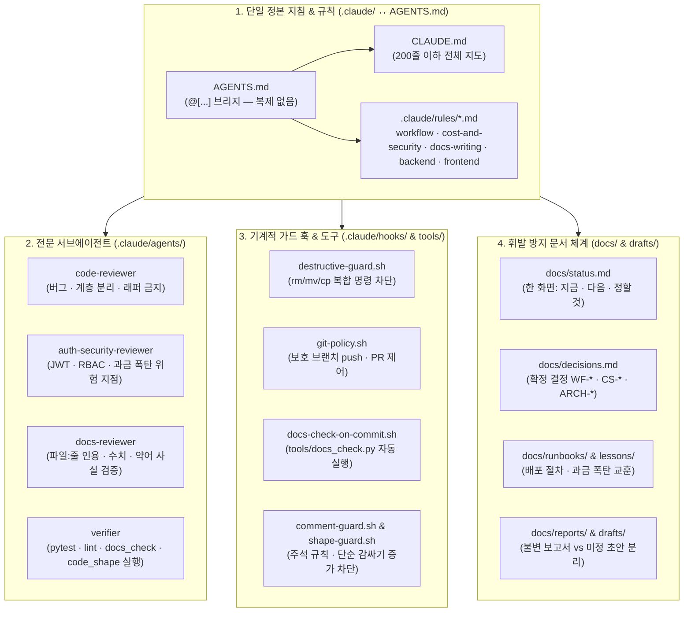

# SLUDemo 워크플로우 분석 및 본 프로젝트 맞춤형 마이그레이션 보고서

2026-10-25 · 상태: **현행** · 관련: [status](../status.md) · [decisions](../decisions.md) · [CLAUDE.md](../../CLAUDE.md)

`/Users/bill/Desktop/dev/ez_agentic_dev/8.slu_sdk_dev/SLUDemo` 의 AI 에이전트 워크플로우를 분석하여, 도메인이 다른 요소(온디바이스 음성 모델, NPU 보드, 원격 `iron` 서버 등)는 걷어내고 **웹서비스 개발 · 도메인 배포 · 과금 폭탄 방지에 꼭 필요한 핵심 거버넌스만 선별해 이식**한 내역을 기록한다.

---

## 1. 마이그레이션 구조도 (Mermaid)

---

## 2. `SLUDemo` 대비 가져온 것 vs 제외·변형한 것 비교

| 영역 | `SLUDemo` 원본 구성 | 본 프로젝트(`To-do-BackendApp`) 반영 내역 | 판단 근거 |
| :--- | :--- | :--- | :--- |
| **정본 브리지** | `CLAUDE.md` + `AGENTS.md`(`@[...]` 참조) | **그대로 도입** (`CLAUDE.md` + `AGENTS.md` 브리지) | Claude Code 와 Antigravity(`agy`)를 함께 쓸 때 규칙이 두 벌로 갈라지는 문제를 원천 방지함 |
| **문서 체계 (`docs/`)** | `status.md`, `decisions.md`, `runbooks/`, `lessons/`, `reports/`, `drafts/`(git 무시) | **핵심 구조 도입** (단, Android/계약/레퍼런스 하위 폴더는 제외하고 경량화) | 대화로만 남기면 다음 세션에 휘발되므로, "지금 위치 · 다음 할 것 · 정할 것"을 `docs/status.md` 한 화면으로 고정 |
| **도메인 규칙 (`.claude/rules/`)** | `workflow.md`, `measurement.md`, `oracle.md`, `android.md`, `ui.md`, `docs-writing.md` | `workflow.md`, `docs-writing.md` 이식 + **`cost-and-security.md`, `backend.md`, `frontend.md` 신설** | 음성 모델 파리티(`oracle.md`)나 보드 계측(`measurement.md`) 대신 사용자의 최대 목표인 **과금 폭탄 방지·보안 경계(`cost-and-security.md`)**를 최상위 상시 규칙으로 배치 |
| **서브에이전트 (`.claude/agents/`)** | `code-reviewer`, `refactor-reviewer`, `docs-reviewer`, `ui-ux-reviewer`, `verifier`, `report-curator` (6종) | **`code-reviewer`, `auth-security-reviewer`, `docs-reviewer`, `verifier` (4종)** 으로 재편 | 정본 파리티용 `refactor-reviewer` 대신 기존 `.github/agents/auth-security-review` 를 흡수·강화한 **`auth-security-reviewer`**(인증 + 클라우드 과금 위험 점검)를 배치 |
| **기계적 훅 (`.claude/hooks/`)** | `destructive-guard`, `git-policy`, `docs-check-on-commit`, `comment-guard`, `naming-guard`, `shape-guard` | **5종 도입** (`destructive-guard`, `git-policy`, `docs-check-on-commit`, `comment-guard`, `shape-guard`) | 파괴적 명령 묶음 차단, 커밋 전 문서 링크/Mermaid/색인 자동 검증, 단순 래퍼 함수 증가 차단은 프로젝트 무관하게 실수를 막는 핵심 장치임 |
| **검사 도구 (`tools/`)** | `docs_check.py`, `code_shape.py`, `iron_checks.sh`, `design_check/` 등 20여 개 | **`docs_check.py`, `code_shape.py`, `comment_guard.py`, `shape_guard.py` 4개만 경량 이식** | 외부 의존성 없이 Python 표준 라이브러리(`ast` 등)와 `npx mmdc` 만으로 즉시 동작하도록 경량화 |

---

## 3. 기존 레포지토리 문서 정리 내역

1. **초기 계획 문서 보관 (`docs/archive/`)**:
   - 루트에 있던 초기 계획서(`implementation_plan.md`, `개인 홈페이지 프로젝트 계획서 (비용 최적화).md`)는 초기 설계 당시의 기록이므로 삭제하지 않고 `docs/archive/` 로 이동·보존하고 색인(`docs/archive/README.md`)을 만들었다.
2. **하위 `AGENTS.md` 정리**:
   - 기존 `backend/AGENTS.md`, `frontend/AGENTS.md` 의 내용은 모두 `.claude/rules/backend.md`, `.claude/rules/frontend.md` 로 통합되었으며, 하위 파일들은 정본 규칙을 가리키도록 정리했다.
