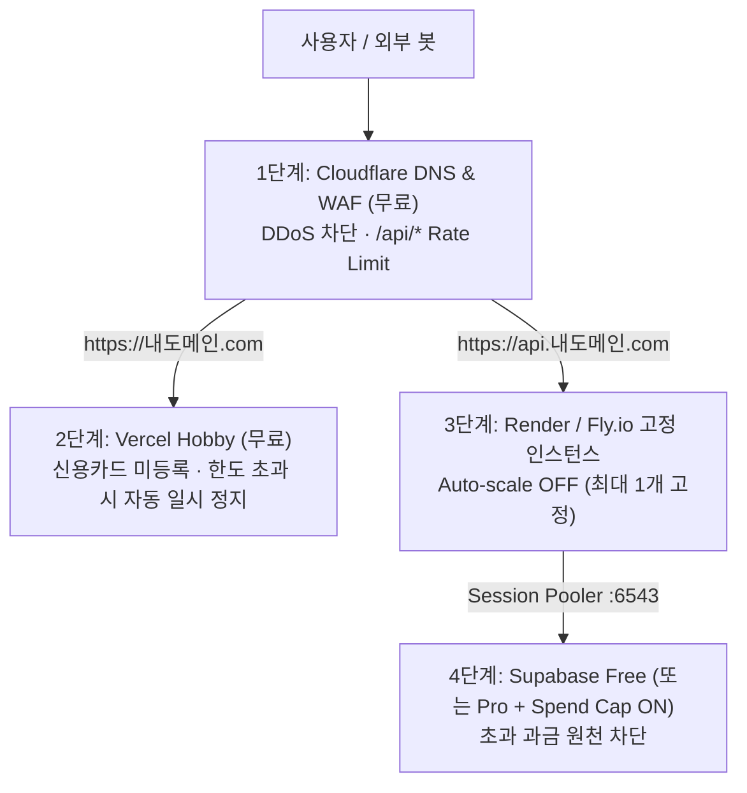

# 과금 폭탄 방지 배포 및 도메인 연결 절차

2026-10-25 · 상태: **현행** · 관련: [runbooks 색인](README.md) · [과금 폭탄 위험 교훈](../lessons/cloud-billing-shock-points.md) · [점검 및 아키텍처 보고서](../reports/2026-10-25_project-inspection-and-cost-architecture.md)

웹서버를 실제 도메인에 연결해 배포하면서 **무제한 종량제 과금 폭탄을 원천 차단(Hard Cap, 결정 CS-1 · CS-2)** 하는 단계별 절차다.

## 1. 전체 배포 방어선 구조

## 2. 플랫폼별 안전 설정 체크리스트

### 2.1. Supabase (Database & Auth)
1. **Free 티어 유지** 또는 Pro 업그레이드 시 **Project Settings > Billing > Spend Cap(지출 한도) 활성화** 여부를 가장 먼저 확인한다.
2. **Authentication > URL Configuration**:
   - `Site URL`: `https://내도메인.com`
   - `Redirect URLs`: `https://내도메인.com/**`, `http://localhost:3000/**` 추가.
3. 가입 승인제(결정 ARCH-1)가 동작하므로, 외부인이 임의 가입하더라도 관리자(`ADMIN_EMAIL`)가 승인하기 전까지는 `Todos` 테이블 쓰기 API(`POST /api/v1/todos/`)가 `403 Forbidden` 으로 차단된다.

### 2.2. Backend 호스팅 (Render 또는 Fly.io)
1. 배포 단위는 `backend/` 디렉토리의 `Dockerfile` 로 설정한다.
2. **Auto-scaling(자동 확장)을 반드시 끈다(인스턴스 수 = 1 고정, 결정 CS-1)**.
3. 환경변수 등록 (절대 프론트엔드에 노출하지 않는 비밀키 포함):
   - `ENVIRONMENT=production`
   - `SUPABASE_URL=https://<프로젝트ID>.supabase.co`
   - `SUPABASE_KEY=<service_role 비밀키>`
   - `SUPABASE_JWT_SECRET=<JWT Secret>`
   - `ALLOW_SUPABASE_AUTH_FALLBACK=false` (결정 CS-4)
   - `DATABASE_URL=postgresql://postgres.<프로젝트ID>:<인코딩된비밀번호>@aws-0-ap-northeast-2.pooler.supabase.com:6543/postgres`
   - `FRONTEND_URL=https://내도메인.com`
   - `ADMIN_EMAIL=<관리자 이메일>`

### 2.3. Frontend 호스팅 (Vercel Hobby)
1. Root Directory 를 `frontend` 로 지정한다.
2. **Hobby(무료) 플랜**을 유지한다(한도 초과 시 과금 대신 일시 정지됨).
3. 환경변수 등록 (공개 가능한 3개만 등록하며, `SUPABASE_KEY` 나 `DATABASE_URL` 은 절대 넣지 않는다):
   - `NEXT_PUBLIC_SUPABASE_URL=https://<프로젝트ID>.supabase.co`
   - `NEXT_PUBLIC_SUPABASE_ANON_KEY=<anon 공개키>`
   - `NEXT_PUBLIC_API_URL=https://api.내도메인.com`

### 2.4. 도메인 구매 및 Cloudflare 앞단 방어선 연결 (결정 CS-2)
1. 도메인 등록기관(Cloudflare Registrar, 가비아, Namecheap 등)에서 도메인을 구매한다.
2. Cloudflare(무료 플랜)에 사이트를 추가하고 도메인의 네임서버(NS)를 Cloudflare 네임서버로 변경한다.
3. **DNS 레코드 설정**:
   - `@` (루트) 및 `www`: Vercel 안내 레코드 연결
   - `api`: 백엔드 호스팅 주소로 CNAME 연결 (Cloudflare Proxy 켜기)
4. **Cloudflare Security > WAF > Rate limiting rules** (무료 규칙 1개 제공):
   - 조건: URI Path starts with `/api/` (또는 호스트네임 `api.내도메인.com`)
   - 제한: 동일 IP 기준 10초당 과도한 요청 발생 시 Block 처리.
