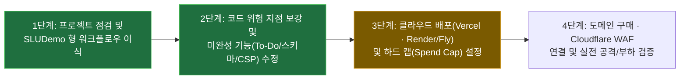

# status — 지금 어디까지 왔나

2026-10-25 · 상태: **현행** · 관련: [decisions](decisions.md) · [docs 색인](README.md) · [runbooks](runbooks/README.md) · [reports](reports/README.md)

**새 세션은 이 문서부터 읽는다.** 한 화면이 목표다 — 2절(지금 · 다음 · 정할 것)을 고치고, 이력에 한 줄을 더한다.

## 1. 목표와 단계

**목표**: Personal Hub(Next.js + FastAPI + Supabase) 웹서비스를 완성하고, **도메인 구매 · 실전 클라우드 배포 · 말도 안 되는 과금(비용 폭탄)이 절대 발생하지 않는 방어 구조와 위험 지점 학습 체계**를 구축한다.

| 단계 | 상태 | 어디까지 |
|---|---|---|
| 1 프로젝트 점검 · 워크플로우 이식 | **끝**(2026-10-25) | 코드 정적 점검 · Mermaid 아키텍처 및 5대 과금 위험 지점 분석([보고서](reports/2026-10-25_project-inspection-and-cost-architecture.md)) · `SLUDemo` 방식 거버넌스(`CLAUDE.md`, `AGENTS.md`, `.claude/rules/`, `.claude/agents/`, `.claude/hooks/`, `docs/`, `tools/`) 이식 완료 |
| 2 코드 위험 지점 · 기능 보강 | **끝**(2026-10-25) | `due_date` 타입(`Optional[datetime]`) 일치 · 입력 상한(`max_length`, `MAX_TODOS_PER_USER=500`, CS-3) · DB 커넥션 풀 상한(`pool_size=5, max_overflow=5`) · 관리자 삭제 예외 원문 은닉 · CSP `connect-src` 배포 도메인 동적 허용 · To-Do 완료(`PUT`)/삭제(`DELETE`) UI 연결 · `pytest` 30개 전수 통과 |
| 3 클라우드 배포 · 비용 상한 설정 | **대기 (다음 단계)** | Supabase Free(또는 Spend Cap) · Vercel Hobby · 고정형 백엔드 컨테이너 배포([런북](runbooks/cost-safe-deployment.md)) |
| 4 도메인 · Cloudflare WAF 연결 | **예정** | 도메인 구매 → Cloudflare 네임서버 연결 → DNS 레코드(`@`, `api`) 및 `/api/*` Rate Limiting 규칙 적용 |

## 2. 지금 · 다음 · 정할 것

**지금(2026-10-25)**:
- **1단계(워크플로우 이식)** 와 **2단계(배포 전 코드 위험 지점 및 To-Do 완료/삭제 기능 보강)** 를 모두 완료했다.
- 보강된 내용:
  - `backend/app/schemas/todo.py`: `due_date` 를 `Optional[datetime]` 으로 ORM 모델과 일치시키고, `title`(`1..200`), `description`(`<=2000`), `priority`(`1..5`), `status`(`"pending" | "completed"`) 제약을 강제했다(결정 CS-3).
  - `backend/app/services/todo_service.py` · `admin_service.py` · `db/database.py`: 사용자당 Todo 최대 건수(`MAX_TODOS_PER_USER = 500`) 및 조회 `limit` 상한 적용, 관리자 회원 삭제 시 내부 예외 문자열 노출 차단, SQLAlchemy 커넥션 풀 상한(`pool_size=5, max_overflow=5`) 설정을 완료했다.
  - `frontend/next.config.mjs` · `TodosPageClient.tsx` · `CalendarView.tsx`: 배포 환경의 `NEXT_PUBLIC_API_URL` origin 을 CSP `connect-src` 에 동적으로 허용하고 `X-Frame-Options: DENY` 로 통일했으며, 할 일 완료 토글(`PUT`)과 삭제(`DELETE`) 버튼을 연결했다.
  - 검증: `python3 tools/docs_check.py`(`rc=0`), `python3 tools/code_shape.py`(`rc=0`), 백엔드 단위 테스트 `pytest` 30건 전수 통과(`rc=0`).

**다음 할 것 (3단계 — 클라우드 배포 및 하드 캡 설정)**:
1. [과금 폭탄 방지 배포 런북](runbooks/cost-safe-deployment.md)에 따라 백엔드(Render 또는 Fly.io 단일 고정 인스턴스)와 프론트엔드(Vercel Hobby)를 배포한다.
2. 도메인 구매 후 Cloudflare 무료 DNS Proxy 및 `/api/*` Rate Limiting 규칙을 연결한다(4단계).

**지금 정해야 할 것 (사용자 결정 사항)**:
1. **백엔드 배포 플랫폼 선택**(`drafts/decision-candidates.md` 후보 2): **Render**(설정 간편, Free/$7 고정)와 **Fly.io** 중 어느 플랫폼으로 3단계 배포를 진행할지 선택해 주세요.
2. **도메인 준비 상태**: 이미 보유하신 도메인이 있는지, 아니면 Cloudflare Registrar 등에서 새로 구매해 연결할지 알려주세요.
3. **`shadcn/ui` 도입 여부**(`drafts/decision-candidates.md` 후보 1): 현행 Tailwind CSS UI로 먼저 배포까지 완주할지, 배포 전에 `shadcn/ui` 컴포넌트로 개편할지 선택해 주세요.

## 3. 열린 문제 (해결 현황)

| 문제 | 위치 | 상태 |
|---|---|---|
| `due_date` 타입 불일치 (`date` vs ISO `datetime`) | `backend/app/schemas/todo.py`, `frontend/src/components/TodosPageClient.tsx` | **해결 완료**(2026-10-25, `Optional[datetime]` 통일 및 단위 시험 검증) |
| To-Do 완료 체크(`readOnly`) 및 삭제 버튼 미구현 | `frontend/src/components/TodosPageClient.tsx` | **해결 완료**(2026-10-25, `handleToggleTodo` `PUT` · `handleDeleteTodo` `DELETE` 연결) |
| 프로덕션 CSP `connect-src` 외부 백엔드 도메인 차단 | `frontend/next.config.mjs` | **해결 완료**(2026-10-25, `NEXT_PUBLIC_API_URL` origin 동적 추가) |
| API 입력 길이(`max_length`) 및 조회 `limit` 미설정 | `backend/app/schemas/todo.py`, `backend/app/services/todo_service.py` | **해결 완료**(2026-10-25, `Field(max_length=...)` 및 `MAX_TODOS_PER_USER=500` 적용) |
| 로컬 `frontend/node_modules` 미설치 상태 | `frontend/` | 로컬에서 `npm run lint` 실행이 필요하면 `cd frontend && npm ci` 실행 필요 (허락 후 진행) |

## 4. 이력

| 날짜 | 한 일 | 문서 |
|---|---|---|
| 2026-10-25 | 2단계 완료 — 백엔드 스키마(`due_date: datetime`, `max_length`)·서비스 상한(`MAX_TODOS_PER_USER=500`)·DB 풀 상한·예외 은닉 보강, 프론트엔드 CSP 동적 origin 허용 및 To-Do 완료/삭제 UI 연결, `pytest` 30개 통과 | [점검·아키텍처 보고서](reports/2026-10-25_project-inspection-and-cost-architecture.md) |
| 2026-10-25 | 1단계 완료 — 프로젝트 전체 정적 점검 · `shadcn/ui` 미도입 확인 · Mermaid 시스템 아키텍처 2종 및 과금 폭탄 5대 위험 지점 보고서 작성 · `SLUDemo` 에이전트 워크플로우 마이그레이션 완료 | [워크플로우 이식 보고서](reports/2026-10-25_workflow-migration-from-sludemo.md) |
