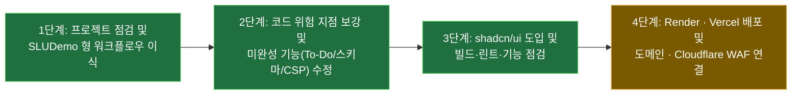

# status — 지금 어디까지 왔나

2026-10-25 · 상태: **현행** · 관련: [decisions](decisions.md) · [docs 색인](README.md) · [runbooks](runbooks/README.md) · [reports](reports/README.md)

**새 세션은 이 문서부터 읽는다.** 한 화면이 목표다 — 2절(지금 · 다음 · 정할 것)을 고치고, 이력에 한 줄을 더한다.

## 1. 목표와 단계

**목표**: Personal Hub(Next.js + FastAPI + Supabase) 웹서비스를 완성하고, **도메인 구매 · 실전 클라우드 배포 · 말도 안 되는 과금(비용 폭탄)이 절대 발생하지 않는 방어 구조와 위험 지점 학습 체계**를 구축한다.

| 단계 | 상태 | 어디까지 |
|---|---|---|
| 1 프로젝트 점검 · 워크플로우 이식 | **끝**(2026-10-25) | 코드 정적 점검 · Mermaid 아키텍처 및 5대 과금 위험 지점 분석([보고서](reports/2026-10-25_project-inspection-and-cost-architecture.md)) · `SLUDemo` 방식 거버넌스 이식 완료 |
| 2 코드 위험 지점 · 기능 보강 | **끝**(2026-10-25) | `due_date` 타입(`Optional[datetime]`) 일치 · 입력 상한(`max_length`, `MAX_TODOS_PER_USER=500`, CS-3) · DB 커넥션 풀 상한 · 관리자 삭제 예외 은닉 · CSP 동적 허용 · To-Do 완료(`PUT`)/삭제(`DELETE`) 연결 · `pytest` 30개 통과 |
| 3 `shadcn/ui` 도입 · 빌드/린트 점검 | **끝**(2026-10-25) | 프론트엔드 `shadcn/ui` 설정(`components.json`, `lib/utils.ts`, CSS 변수 토큰) 및 7종 부품(`button`, `input`, `card`, `badge`, `table`, `checkbox`, `label`) 전 화면 적용 · `npm run lint` · `tsc --noEmit` · `next build` 통과 |
| 4 Render · Vercel 배포 · 도메인 연결 | **대기 (다음 단계)** | 백엔드 Render 배포 확정(ARCH-3) · 도메인 시장조사 완료([도메인 비교 보고서](reports/2026-10-25_domain-market-research.md)) → 로컬 브라우저 최종 눈 확인 후 배포 및 Cloudflare WAF 연결([런북](runbooks/cost-safe-deployment.md)) |

## 2. 지금 · 다음 · 정할 것

**지금(2026-10-25)**:
- **초안(`drafts/`)의 정본 승격(`ARCH-5`, `WF-9`) 및 모델별 전담 에이전트 분리 구성**을 완료했다:
  - **모델별 전담 에이전트 3종 구성(결정 WF-9)**:
    - [`backend-dev`](../.claude/agents/backend-dev.md): **Gemini 4 Argon** (`model: gemini-4-argon`, `Model="inherit"`) — 백엔드/DB 스키마/보안/아키텍처 하니스 전담.
    - [`frontend-dev`](../.claude/agents/frontend-dev.md): **Gemini 3.8 Flash** (`model: gemini-3.8-flash`, `Model="flash"`) — Next.js 프론트엔드 UI/컴포넌트 전담.
    - [`html-mockup-writer`](../.claude/agents/html-mockup-writer.md): **Gemini 3.8 Flash** (`model: gemini-3.8-flash`, `Model="flash"`) — 단독 실행형 HTML 디자인 목업(`drafts/mockups/personal-hub-standalone-mock.html`, `todo-calendar-workspace.html`) 전담 작성 완료.
  - **백엔드 · DB 스키마 및 규칙 승격(결정 ARCH-5, WF-9)**:
    - `backend/app/models/todo.py` · `backend/app/schemas/todo.py`: 멀티데이 일정(`started_on`), 카테고리(`category`, `TodoCategory` Literal, `S8`), 소프트 삭제 3종 세트(`deleted_at`, `deleted_by`, `delete_reason`, `S7`) 및 중복 허용 docstring(`S2`) 반영.
    - `backend/app/services/todo_queries.py` · `todo_service.py` · `endpoints/todos.py`: 읽기 전용 캘린더 기간 조립(`TodoQueries`)과 쓰기 트랜잭션(`TodoService`) 분리(`R3`, `C2`, `C3`).
    - `backend/alembic/versions/8c3e19a4d701_add_calendar_span_and_soft_delete_to_todos.py`: 스키마 확장 및 활성 행 부분 인덱스(`ix_todos_user_due_live WHERE deleted_at IS NULL`, `S6`) 마이그레이션 추가.
    - `.claude/rules/backend.md` 및 `backend/tests/test_architecture_harness.py`: `P1~P5`, `R1~R5`, `C1~C5`, `S1~S8` 규칙 편입 및 AST/스키마 자동 하니스 + Red-check 구현 (`pytest` 36개 전체 통과).

**다음 할 것 (로컬 확인 · DB 마이그레이션 반영 · 4단계 배포 진입)**:
1. 단독 HTML 디자인 목업(`drafts/mockups/personal-hub-standalone-mock.html`) 및 실행 중인 로컬 웹(`http://localhost:3000/todos`)에서 UI/UX를 확인한다.
2. 일시 정지된 Supabase 프로젝트를 재개(Restore)한 뒤 `alembic upgrade head` 로 신규 컬럼(`started_on`, `category`, 소프트 삭제 3종 세트)을 실제 DB에 반영한다.
3. 확인 후 [과금 폭탄 방지 배포 런북](runbooks/cost-safe-deployment.md)에 따라 Render(백엔드, 결정 ARCH-3) + Vercel Hobby(프론트엔드) 배포 및 도메인 연결로 넘어간다.

**지금 정해야 할 것 (사용자 확인 사항)**:
1. **단독 HTML 디자인 목업 및 워크스페이스 확인**: `html-mockup-writer`(Flash 3.8) 에이전트가 생성한 `drafts/mockups/personal-hub-standalone-mock.html` 화면 구성에서 추가로 다듬고 싶은 UI/기능이 있으신가요?
2. **Supabase DB 재개 및 배포 진입 시점**: Supabase 대시보드에서 프로젝트를 Restore 하신 뒤 `alembic upgrade head` 실행과 Render · Vercel 실제 배포 단계로 바로 넘어갈지 알려주시면 됩니다.

## 3. 열린 문제 (해결 현황)

| 문제 | 위치 | 상태 |
|---|---|---|
| `due_date` 타입 불일치 (`date` vs ISO `datetime`) | `backend/app/schemas/todo.py`, `frontend/src/components/TodosPageClient.tsx` | **해결 완료**(2026-10-25, `Optional[datetime]` 통일 및 단위 시험 검증) |
| To-Do 완료 체크(`readOnly`) 및 삭제 버튼 미구현 | `frontend/src/components/TodosPageClient.tsx` | **해결 완료**(2026-10-25, `shadcn/ui` `Checkbox` · `Button` 으로 `PUT`/`DELETE` 연결) |
| 프로덕션 CSP `connect-src` 외부 백엔드 도메인 차단 | `frontend/next.config.mjs` | **해결 완료**(2026-10-25, `NEXT_PUBLIC_API_URL` origin 동적 추가) |
| API 입력 길이(`max_length`) 및 조회 `limit` 미설정 | `backend/app/schemas/todo.py`, `backend/app/services/todo_service.py` | **해결 완료**(2026-10-25, `Field(max_length=...)` 및 `MAX_TODOS_PER_USER=500` 적용) |
| 로컬 `frontend/node_modules` 및 ESLint/빌드 검증 | `frontend/` | **해결 완료**(2026-10-25, 의존성 설치 · `.eslintrc.json` 구성 · `npm run lint` 및 `next build` 통과) |

## 4. 이력

| 날짜 | 한 일 | 문서 |
|---|---|---|
| 2026-10-25 | 백엔드(`backend-dev`: Gemini 4 Argon) · 프론트엔드(`frontend-dev`: Gemini 3.8 Flash) · HTML 목업(`html-mockup-writer`: Gemini 3.8 Flash) 에이전트 분리(WF-9) · 백엔드 스키마/쿼리 분리(`ARCH-5`) 및 아키텍처 하니스(`test_architecture_harness.py`, `pytest` 36개 통과) 정본 승격 완료 | [decisions (WF-9, ARCH-5)](decisions.md) · [승격 비교 보고서](reports/2026-10-25_draft-to-kb-and-rules-promotion.md) |
| 2026-10-25 | 파스텔 민트(`#8ee3be`) 테마 적용 · `model-hub` 참조 To-Do/캘린더 HTML 목업 및 백엔드/DB/프론트엔드 설계 초안(`drafts/`) 작성 · 프론트엔드 캘린더/백로그/미니스트립 컴포넌트(`frontend/src/components/todos/*`) 실제 이식 · 초안→KB/룰 승격 체계 비교 분석 보고서 작성 | [승격 비교 보고서](reports/2026-10-25_draft-to-kb-and-rules-promotion.md) |
| 2026-10-25 | 3단계 완료 — `shadcn/ui` 7종 컴포넌트(`Button`, `Input`, `Card`, `Badge`, `Table`, `Checkbox`, `Label`) 도입 및 전체 화면 리팩토링, `npm run lint` · `tsc` · `next build` 통과 | [decisions (ARCH-4)](decisions.md) |
| 2026-10-25 | 백엔드 배포 플랫폼 Render 확정(ARCH-3) · 배포 전 `shadcn/ui` 도입 및 기능 점검 확정(ARCH-4) · 도메인 확장자/대행사 시장조사 보고서 작성 | [도메인 시장조사 보고서](reports/2026-10-25_domain-market-research.md) · [decisions](decisions.md) |
| 2026-10-25 | 2단계 완료 — 백엔드 스키마(`due_date: datetime`, `max_length`)·서비스 상한(`MAX_TODOS_PER_USER=500`)·DB 풀 상한·예외 은닉 보강, 프론트엔드 CSP 동적 origin 허용 및 To-Do 완료/삭제 UI 연결, `pytest` 30개 통과 | [점검·아키텍처 보고서](reports/2026-10-25_project-inspection-and-cost-architecture.md) |
| 2026-10-25 | 1단계 완료 — 프로젝트 전체 정적 점검 · `shadcn/ui` 미도입 확인 · Mermaid 시스템 아키텍처 2종 및 과금 폭탄 5대 위험 지점 보고서 작성 · `SLUDemo` 에이전트 워크플로우 마이그레이션 완료 | [워크플로우 이식 보고서](reports/2026-10-25_workflow-migration-from-sludemo.md) |
